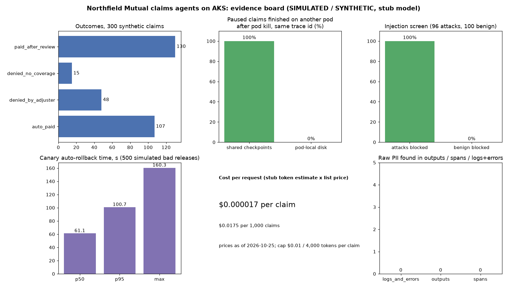
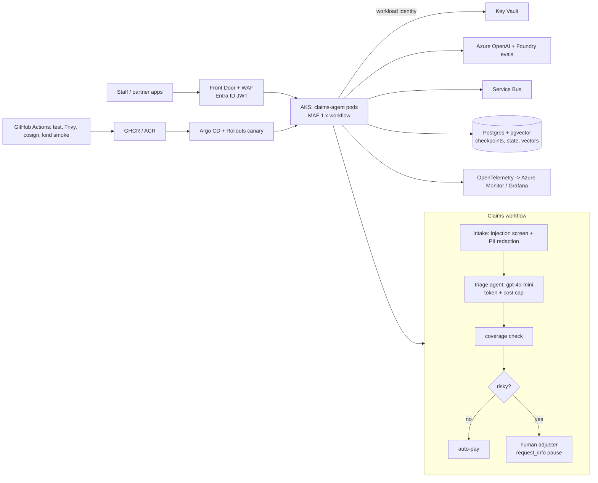

# Jagadish-azure-aks-agent-platform

**Enterprise agent platform reference build: Microsoft Agent Framework 1.x claims agents for Northfield Mutual (a fictional insurer), packaged with Docker, run on Kubernetes (kind locally, AKS by design), shipped by GitHub Actions and Argo CD, and described end to end in Terraform.**

## At a glance (for recruiters)

- **Problem:** the common "production stack" diagram (load balancer, backend, queue, Kafka, OpenSearch, Postgres, Helm, Argo CD, Terraform, metrics) has no identity edge, no secrets story, two overlapping brokers and two overlapping search stores, no AI layer, and no release safety.
- **Approach:** a working claims workflow (intake guards, model triage, coverage check, human approval for risky payouts) that survives pod kills, plus the platform around it with those five gaps fixed.
- **Proof:** every number below comes from `python scripts/run_measurements.py` on synthetic data and is checked in CI. All of it is **simulated / synthetic with a labelled stub model**. A live run was attempted and is reported honestly below.

<!-- numbers:start -->
| Measure (simulated / synthetic, stub model) | Result |
| --- | --- |
| Automated tests | **151** |
| Synthetic claims run end to end | 300 (auto_paid 107, denied_by_adjuster 48, denied_no_coverage 15, paid_after_review 130) |
| Paused for a human adjuster | 178 of 300 |
| Trace continuity after pod kill, shared checkpoints | 100% (178 of 178 finished on another pod) |
| Same test, pod-local disk (baseline) | 0% (0 of 37) |
| Injection block rate | 100% of 96 attacks; false positives 0 of 100 benign |
| Canary auto-rollback time (simulated, 500 bad releases) | p50 61.1 s, p95 100.7 s |
| Cost per request (stub token estimate x list price as of 2026-10-25) | $0.000017 ($0.0175 per 1,000) |
| Raw PII in outputs / spans / logs+errors | 0 / 0 / 0 |
| Live model run | **not done**: the provided key had no API credit (HTTP 429 insufficient_quota) |
<!-- numbers:end -->



## Why it exists

Insurers want agents that triage claims, but a payout is money leaving the company. The platform has to prove four things before anyone signs off: only signed-in staff can call it, no key ever sits in a pod, a risky payout always waits for a human even if a pod dies in the middle, and a bad release backs itself out. This repo shows one way to do all four on Azure, with the parts you can run for free running in CI.

## Architecture




Five gaps fixed against the common stack: see [docs/architecture.md](docs/architecture.md#five-gaps-fixed).

## How it works

1. A request arrives with a bearer token and a W3C `traceparent`. The service checks issuer, audience, expiry and role (`Claims.Submit` or `Claims.Adjust`).
2. **Intake** rejects prompt-injection text before any model call and redacts phone, email, SSN, card (Luhn-checked) and names.
3. **Triage** is an MAF `Agent` on the configured model. Output must be strict JSON (exact keys, bounded score, NaN rejected). Bad output or a model outage routes to a human, never to auto-pay. A per-claim token and dollar cap escalates instead of overspending.
4. **Coverage** checks the synthetic policy (active, right line, limit, deductible).
5. **Decision** auto-pays low-risk claims. Otherwise it calls `ctx.request_info(...)` and the workflow pauses with a checkpoint.
6. Any pod can later load the checkpoint, re-surface the pending request and apply the adjuster's decision, under the same trace id.

Code excerpt (`src/nfclaims/workflow.py`):

```python
reasons = risk_reasons(s)
if not reasons:
    await ctx.yield_output(outcome(s, "auto_paid", "low risk", payout=s.coverage["payable"]))
    return
ctx.set_state("claim", s)
await ctx.request_info(AdjusterReview(s.claim_id, s.coverage["payable"], reasons, s.triage.get("summary", "")), AdjusterDecision)
```

Real output of one paused claim finished on another pod (from `run_claims_and_pod_kill`, stub model):

```text
{'claim_id': 'CLM-5029', 'status': 'paid_after_review', 'reason': 'approved by adjuster',
 'steps': ['intake', 'triage', 'coverage', 'decision', 'adjuster'], 'payout': 17811.71, ...}
```

## Run it

Offline (no keys, stub model):

```bash
python -m venv .venv && . .venv/bin/activate && pip install -e ".[dev]"
pytest -q
python scripts/run_measurements.py     # writes results/metrics.json
python scripts/boards.py               # evidence board + architecture PNG
DEV_TOKEN_KEY=$(openssl rand -hex 24) uvicorn nfclaims.app:app --port 8080
```

Local Kubernetes (free): `kind create cluster --config deploy/kind/kind-config.yaml && ./deploy/kind/smoke.sh`.

Live model (costs money, a few cents for 120 calls):

```bash
export MODEL_PROVIDER=openai OPENAI_API_KEY=...        # OpenAI API, gpt-4o-mini
# or: MODEL_PROVIDER=azure AZURE_OPENAI_ENDPOINT=... AZURE_OPENAI_API_KEY=... AZURE_OPENAI_DEPLOYMENT=gpt-4o-mini AZURE_OPENAI_API_VERSION=2024-10-21
python scripts/live_run.py --max-calls 120             # hard cap 200 calls
```

Azure: `infra/terraform` passes `terraform validate`. It has never been planned or applied. See [docs/deploy.md](docs/deploy.md) for the gated steps and a cost list.

## Guardrails

Entra ID at the edge plus claim checks in the service, dev tokens refused when `APP_ENV=prod`, injection screen before the model, PII redaction in outputs, spans, logs and exception text, strict output schema, fail-safe to a human, token and dollar caps, workload identity (no keys in pods), non-root read-only containers, default-deny NetworkPolicy, Trivy gate, cosign keyless signing, gitleaks over full history, CodeQL, Dependabot. Details: [docs/guardrails.md](docs/guardrails.md), [docs/threat-model.md](docs/threat-model.md).

## Built vs planned

| Part | Status |
| --- | --- |
| MAF 1.x claims workflow, HITL pause and resume across pods | **Built, tested** |
| Guards: injection screen, PII redaction incl. logs/errors, cost caps, strict JSON | **Built, tested** |
| FastAPI service, dev-token auth, Prometheus metrics, OTel spans | **Built, tested** |
| Provider switch: stub / OpenAI API / Azure OpenAI | **Built**; stub tested; live call attempted, blocked by zero API credit |
| Measurements (pod kill, injection, rollback sim, cost) | **Built, simulated / synthetic** |
| Dockerfile, Helm chart, Argo CD app, Rollouts canary + analysis | **Written**; Helm lint/template in CI; image + kind smoke run in CI |
| GitHub Actions: tests, Trivy, cosign keyless sign, kind smoke | **Written, runs in CI** |
| Terraform: AKS, ACR, Key Vault, workload identity, Service Bus, Postgres + pgvector, Azure OpenAI, Foundry, Front Door WAF, Monitor, budget | **Written, `terraform validate` only, never applied** |
| Grafana dashboard JSON, OTel collector config | **Written, not run** |
| Postgres checkpoint store (today: shared volume) | Planned |
| APIM in front of AKS (Front Door chosen for now) | Planned |
| Bicep parity, Foundry eval pipeline run, live AKS deploy | Planned (live deploy needs owner's yes and costs money) |

## Limitations

- The stub decides severity from amount and prior claims; it is not a model-quality result. No live-model accuracy is claimed.
- The injection set is 96 self-written attacks and 100 benign texts: a regression check, not a benchmark. Paraphrased attacks will get past a regex screen; the strict schema and human gate are the backstops.
- Rollback time is a simulation of the canary settings, not a measured cluster rollback.
- Cost uses estimated tokens (chars/4) and assumed list prices.
- Pods "killed" in the measurement are in-process service objects; the kind smoke test is where a real pod is deleted.

## Docs

[architecture](docs/architecture.md) · [how it works](docs/how-it-works.md) · [guardrails](docs/guardrails.md) · [threat model](docs/threat-model.md) · [deploy](docs/deploy.md) · [implementation guide](docs/implementation-guide.md) · [interview points](docs/interview-points.md) · [ADRs](docs/adr/)

## Related repos

- [Jagadish-azure-agent-platform](https://github.com/jagadishmazure-jpg/Jagadish-azure-agent-platform): the Container Apps + `azd` version (mortgage underwriting, A2A, MCP). This repo is the AKS + GitOps version.
- [Jagadish-enterprise-agent-usecases](https://github.com/jagadishmazure-jpg/Jagadish-enterprise-agent-usecases): 22 use-case agents.

MIT licensed. All companies, people and claims are fictional.
