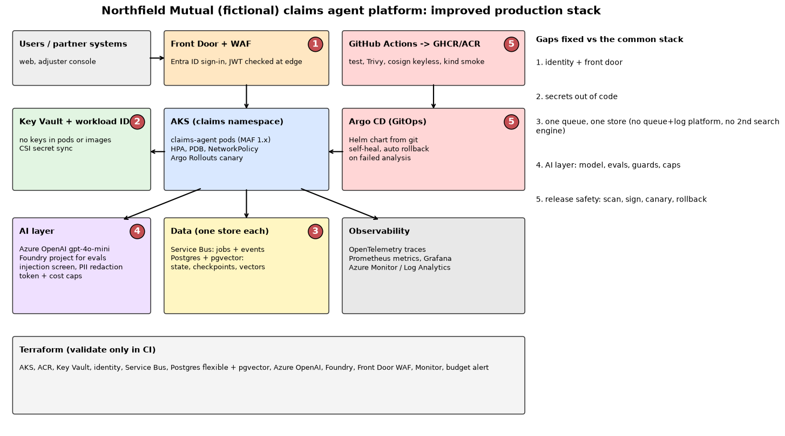

# Architecture

## Layers

| Layer | Azure (design) | Local / CI (running) |
| --- | --- | --- |
| Edge and identity | Front Door Premium + managed WAF rules; Entra ID app registration, roles `Claims.Submit`, `Claims.Adjust` | HS256 dev tokens, same claim checks |
| Runtime | AKS, workload identity, Azure CNI + network policy, Azure Policy | kind (Docker) |
| Agents | Microsoft Agent Framework 1.x workflow in each pod | same code |
| Model | Azure OpenAI `gpt-4o-mini` deployment (keyless via managed identity); Foundry project for evaluations | labelled stub; OpenAI API optional |
| Secrets | Key Vault, CSI secret store driver, federated credential | none needed |
| Messaging | Service Bus queue `claims-intake` with dead-lettering | in-process |
| State | Postgres flexible server, Entra auth only, `pgvector` allowed | shared checkpoint volume |
| Delivery | GitHub Actions -> GHCR/ACR -> Argo CD -> Argo Rollouts canary | GitHub Actions + kind smoke |
| Observability | OpenTelemetry -> Azure Monitor / Log Analytics, managed Prometheus, Grafana | in-memory span exporter, `/metrics` |
| Cost | budget alert on the resource group, per-claim token and dollar caps | per-claim caps |

## Five gaps fixed

The common production-stack picture is a good start. These are the five changes made to it, and where each one lives in this repo.

1. **Identity and a front door.** Nothing reaches the backend without a token. Front Door + WAF at the edge (`azurerm_cdn_frontdoor_*` in Terraform), role checks inside the service (`src/nfclaims/auth.py`).
2. **Secrets.** Pods get an Azure identity through a federated credential, not a key (`azurerm_federated_identity_credential`, Helm `workloadIdentity.clientId`). Azure OpenAI, Service Bus and Postgres have key or password auth turned off in Terraform.
3. **Duplicates removed.** One broker (Service Bus) instead of a job queue plus a separate event-log platform, and one database (Postgres with pgvector) instead of Postgres plus a separate search cluster. A dedicated search service is added only if search quality needs it. A test fails if either duplicate comes back.
4. **An AI layer.** Model deployment and a Foundry project for evaluations, plus guards in the request path: injection screen, PII redaction, strict output schema, token and dollar caps, human approval for risky payouts.
5. **Release safety.** Trivy gate, cosign keyless signing, kind smoke test with a pod kill, Argo CD self-heal, Argo Rollouts canary with automatic abort on a failing error-rate analysis.

## Why checkpoints live outside the pod

The pod-kill measurement compares two set-ups on the same claims. With shared checkpoint storage every paused claim was finished by another pod under the same trace id. With pod-local storage none were. See the numbers table in the README.
