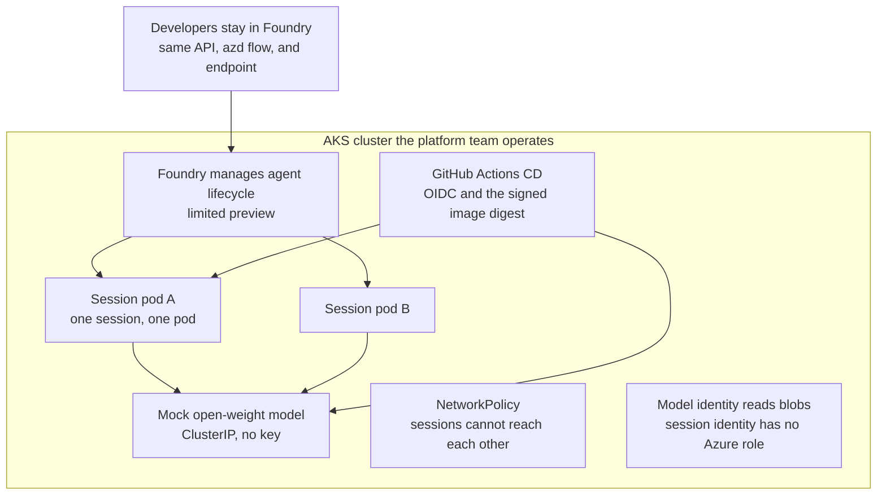

# Foundry models and hosted agents on AKS

This page is the platform-engineering view of running Foundry hosted agents and open-weight models on a cluster this team already operates. It follows the limited-preview description in [Run models and agents on your own Kubernetes clusters](https://techcommunity.microsoft.com/blog/appsonazureblog/run-models-and-agents-on-your-own-kubernetes-clusters-aks-at-microsoft-ignite-20/4573912) (17 November 2026).

The product name in that post is AKS AI Manager for Foundry. Developers keep the Foundry API, the Azure Developer CLI flow, and the same endpoint. Foundry manages the agent lifecycle and its integration components. The platform team keeps the cluster, node pools, networking, container registry, storage, identity, and policy.

This repository does not call that preview. It renders the platform contract so the isolation rules can be tested with `helm template` and a small policy evaluator. Nothing here has been applied to a live cluster.

There is no edge from session A to session B. Both may call the model. The model may not call the sessions.

## What the chart installs

`deploy/helm/foundry-on-aks` installs into a namespace a cluster admin has already created (`deploy/k8s/foundry-namespace.yaml`):

| Object | Role |
| --- | --- |
| Pod `session-<id>` | One pod per session id. `restartPolicy: Never`, so a crashed sandbox is not started again. |
| Deployment `open-weight-model` | One replica of a fixed-JSON stub. It is the serving shape, with probes, a ClusterIP, and a read-only root filesystem. |
| NetworkPolicy | Default deny for the namespace, per-session egress, and model ingress from session pods only. |
| ServiceAccount | `open-weight-model` and `session-sandbox`, annotated for workload identity when a client id is set. |
| ResourceQuota and LimitRange | A session cannot ask for an unbounded pod count or container size. |

The namespace labels turn on restricted Pod Security Admission. A pod that asks for root, host namespaces, or added capabilities is rejected even if it was not rendered by this chart.

The container image is the claims image this repository already builds and signs. Session pods sleep. The model pod runs `files/mock_model.py`, which returns the same JSON for every `POST /v1/chat/completions` and discards the prompt. That keeps CD on one signed digest. It is a stand-in for an open-weight server, and the weights are not in the image.

## Isolation layers

A session that can run model-generated code needs more than a separate pod.

1. **Pod boundary.** Each session id becomes one pod. The pod runs as uid 10001, drops all capabilities, sets `allowPrivilegeEscalation: false`, uses a read-only root filesystem, and mounts only a size-capped `emptyDir` on `/tmp`. `enableServiceLinks: false` keeps other Service names out of the environment. `automountServiceAccountToken: false` leaves the Kubernetes API token off the pod.
2. **VM boundary, when the pool exists.** `values-aks.yaml` sets `runtimeClassName: kata-vm-isolation`. That class is the documented AKS pod-sandboxing runtime: each pod runs in a lightweight VM on an Azure Linux node pool whose workload runtime is `KataVmIsolation`. See [Pod sandboxing on AKS](https://learn.microsoft.com/en-us/azure/aks/use-pod-sandboxing). CD does not pass this file, because the default node pool is not that pool and `helm --wait` would sit on Pending pods.
3. **Network boundary.** The namespace starts at default deny. A session policy allows egress to `kube-dns` on port 53 and to the model pod on TCP 8080. The model accepts ingress only from session pods of this release, on TCP 8080. Session pods have no ingress allow. The claims namespace is not a peer. Policies are evaluated in `tests/test_foundry_on_aks.py` without a cluster.
4. **Identity boundary.** Terraform federates four user-assigned identities. The prod model identity has Storage Blob Data Reader on the Foundry storage account. The prod session identity, and both dev identities, have no data-plane role. A dev deploy token can write `foundry-sessions-dev` and cannot write `foundry-sessions`.
5. **Quota.** The ResourceQuota caps pods, requests, and limits for the namespace.

The claims chart still allows egress on 443 with no destination selector. A claims pod that tries to open 443 to a session is dropped by the session namespace, which has no ingress allow. The policy test locks that pair of results.

## How CD ships it

`.github/workflows/azure-deploy.yml` helm-upgrades this chart after the claims release, into `foundry-sessions-dev` or `foundry-sessions`. The values file carries the ACR repository, the signed digest, and the two client ids for that environment. Helm stores release state in ConfigMaps, the same way the claims release does, because the namespace Writer role does not read Secrets.

When both Foundry client-id variables are unset, the step prints `Foundry-on-AKS chart skipped` and the claims deploy continues. When only one is set, the step fails. The chart does not create the namespace.

Optional Terraform pools stay at count 0 until you set the variables:

| Variable | Default | What a true value creates |
| --- | --- | --- |
| `foundry_sandbox_pool_enabled` | false | User pool `fsbox`, `os_sku = AzureLinux`, `workload_runtime = KataVmIsolation`, taint `workload=foundry-session:NoSchedule` |
| `foundry_gpu_pool_enabled` | false | User pool `fgpu`, `gpu_driver = Install`, taint `sku=gpu:NoSchedule` |

`model.gpu.enabled` in the chart is also false. Turning it on adds an `nvidia.com/gpu` limit and the matching toleration. Leave it off until the pool exists.

## Preview details to confirm before a live cluster

Items marked **[verify]** are taken from the announcement or from current AKS docs and are not exercised by this repository.

- **[verify]** Hosted agents on AKS and open-weight model deploy from Foundry are limited preview. Enrollment, the control-plane API, and the component that creates session pods are outside this chart. azurerm 4.81 has no resource for that control plane.
- **[verify]** The announcement describes one pod per session inside a lightweight VM via AKS pod sandboxing. The Agent Sandbox extension, built on the [Kubernetes Agent Sandbox](https://agent-sandbox.sigs.k8s.io/) project, is a related preview for model-generated code (`Sandbox` in `agents.x-k8s.io/v1beta1`, plus template, warm-pool, and claim resources). This chart renders a Pod, because CI has no CRD controller and the Foundry session controller is the preview's job.
- **[verify]** `kata-vm-isolation` is the GA runtime class. `kata-vm-isolation-v2` is preview (`KataVMIsolationV2Preview`, Kubernetes 1.34 or later). The v2 class in this chart also sets `emptyDir.medium: Memory`, which the v2 docs require. Which class the Foundry preview pins is unpublished here.
- **[verify]** Session ingress is closed. The preview may need a peer from the Foundry data plane. Open that peer only after the preview names it. An allow from every session pod would remove the isolation this chart is here to show.
- **[verify]** Session pods set `automountServiceAccountToken: false` and still carry the workload-identity label when a client id is set. Confirm that the webhook injects only the Azure token you expect before relying on a session call to Azure.
- **[verify]** Blob Data Reader is granted on the whole Foundry storage account. Narrow it to the artifact prefix the preview documents.
- **[verify]** `Standard_D2s_v5` and `Standard_NC4as_T4_v3` are placeholders. Confirm nested virtualization, GPU availability, and zone support before setting either pool variable to true. Both pools are omitted from `terraform validate`'s created set while the flags stay false; validate still type-checks the resources.
- **[verify]** The same announcement describes a serverless sandbox runtime and pod memory snapshots. This chart does not select either.
- **[verify]** The cluster uses Azure network policy (`network_policy = "azure"`). Re-check the DNS peer (namespace selector plus `k8s-app: kube-dns`) on the dataplane version you run.

## What CI proves

`helm lint` and `helm template` run in the helm job. `tests/test_foundry_on_aks.py` renders the chart and checks the objects directly:

- two session ids produce two pods, and a bad or duplicate id fails the template
- session A cannot send to session B, the model cannot send to a session, and a session can send to the model on TCP 8080
- DNS egress is limited to the kube-dns pod
- a claims pod is not an ingress peer of a session or the model
- GPU, the Kata runtime class, and workload identity appear only when values turn them on
- the stub server returns fixed JSON, ignores the prompt, and rejects a body over 64 KiB

A kind cluster is not required for these checks.
